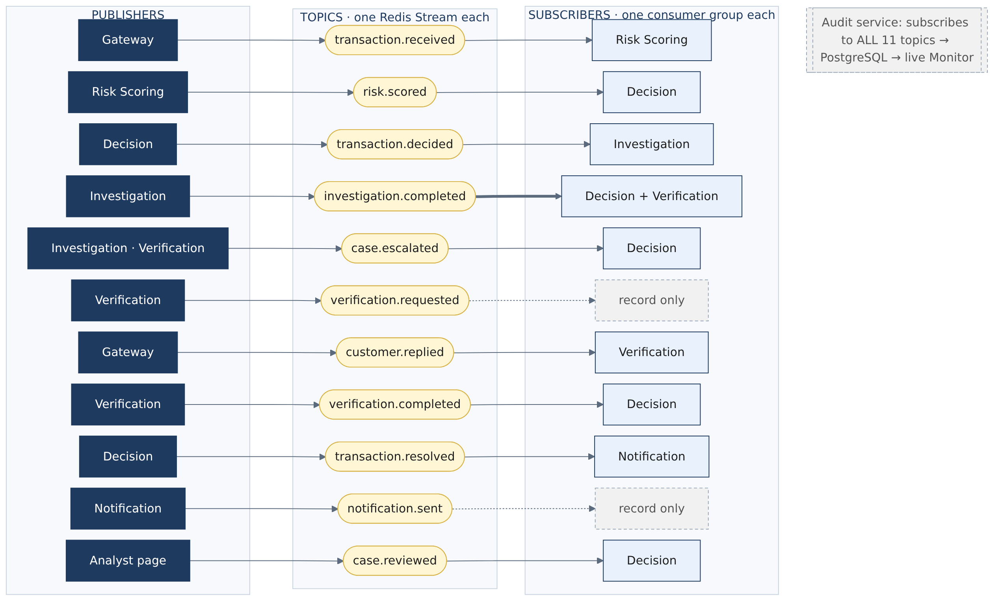

# Fraud Agents: an event-driven, multi-agent AI fraud detection system

A capstone project (Centennial College, COMP385) by **Omair Khan**.

Card payments arrive as signed webhooks and become **events**. The agents talk to each other only through **Pub/Sub**: each kind of event is a **topic**, every agent **subscribes** to the topics it needs and **publishes** new events, and no agent ever calls another one directly. Small, independent **agents** each read the events they care about and publish new ones:

- an XGBoost model scores every payment;
- plain rules decide what happens;
- AI agents (LangChain and LangGraph, with a local Llama model) investigate suspicious payments and text the customer;
- a human analyst has the final say when the system can't decide.

Every event is kept in a PostgreSQL audit log, and a Streamlit Monitor shows it all live.

**The design rule:** *the AI advises, rules decide, and a human can override.* No AI output on its own can release a payment.

---

## How a payment flows

```
payment source --signed webhook--> gateway --> Risk Scoring (XGBoost) --> Decision (rules)
        ^                             |                                    approve | flag | hold
        |   answer in ~25 ms:         |   <-- transaction.decided --------------+
        +-- approved, or declined ----+                                            | flag or hold
            (soft) for now                                                         v
   Investigation (AI: LangGraph, 3 tools, checked report)
      --> Verification (AI + rules: texts the customer, pauses until the reply, saved in PostgreSQL)
             <--signed reply webhook-- mock SMS provider (simulated customer)
      --> Decision (final-outcome rules): blocked | released | sent_to_analyst
      --> Notification (AI draft, rule check, safe template fallback) --SMS--> customer
   Analyst page (Monitor) --case.reviewed--> Decision --> final outcome --> Notification

every event --> audit log (PostgreSQL) --> Fraud System Monitor (Streamlit)
every AI call --> llm_calls table
```

### The answer at the till

A card network needs the bank's answer in a few hundred milliseconds, so the slow lane (AI investigation, texting the customer) can't happen before it. The gateway therefore:

1. publishes the payment and **waits up to 300 ms** (`DECISION_DEADLINE_MS`) for the Decision agent's verdict. It *listens live* to `transaction.decided`: every gateway process reads each new verdict, and old ones are never replayed. In replays with the real Risk Scoring (XGBoost + SHAP) and Decision agents, the answer came back in a median of about 20–25 ms (slowest about 50 ms, on a sandbox machine);
2. answers **approved** (low risk) or **declined (soft)**. A *soft decline* means "declined for now": the customer gets a "did you just try to pay…?" text. No verdict in time also gives a soft decline, and the customer simply taps again;
3. keeps each payment's status (it also subscribes to `transaction.resolved`, as a durable consumer group). The payment source can ask at any time: `GET /payments/{txn_id}` (signed over the method and path). For example, it might answer "declined for now: waiting for the customer to confirm";
4. when the customer replies **YES** (or an analyst releases the payment), allows **one** retry within 30 minutes (`RETRY_WINDOW_SECONDS`) of the same card, shop (name, type and location) and amount. The retry is marked `confirmed_retry_of`, and the Decision rules approve it. If that retry itself gets no verdict in time, the YES is kept for the next try.

A payment gets exactly **one** answer:
- a resent webhook gets the same answer as the first request (the payment is claimed atomically with `SET NX`, and the answer is stored once with `HSETNX`);
- if the gateway dies mid-wait, a resend gets a soft decline. Nothing has moved, so the customer simply tries again.

The replayer plays the card terminal and the customer at the till. It prints each answer and how long it took, and it retries the payments the customers confirmed.

### How Pub/Sub works here



- **Topic = one Redis Stream** (e.g. `events:transaction.resolved`). There are 11 topics, one per event form.
- **Subscriber = one consumer group.** Every group gets its own copy of every event, so one event can reach several agents. For example, `investigation.completed` goes to both Decision and Verification, and the Audit service subscribes to all 11 topics.
- **Why Redis Streams and not Redis's own "Pub/Sub" feature.** That feature is *at-most-once*: a message sent while a subscriber is down is lost for good. A stream is a **durable log**:
  - each group keeps its own place in it;
  - an event is acknowledged (`XACK`) only after it is handled;
  - an event a crashed subscriber never finished is delivered again;
  - an event that keeps failing goes to a dead-letter stream (`events:dead`) and its case goes to an analyst.

  A fraud system can't lose payments. Two tests show the difference: a subscriber that was down still gets what it missed, and a crashed one gets the event again.
- **Durable Redis.** Events live in Redis before the Audit service copies them into PostgreSQL, so Redis writes every event to disk before confirming it (`appendonly yes` + `appendfsync always` in `compose.yaml`).
- **Webhooks only at the edges.** Outside parties (the payment source, the SMS provider) use signed webhooks; inside the system it is Pub/Sub only.

The step-by-step flow of one payment, event by event, is in [docs/images/sequence.png](docs/images/sequence.png) (the sources of both diagrams are in `docs/diagrams/`).

| Program | What it does | Technology |
| --- | --- | --- |
| Gateway | Receives signed payment webhooks and customer-reply webhooks. Replaces card numbers with keyed tokens and refuses the dataset's answer key. **Answers each payment** (approved / soft-declined), keeps its status (`GET /payments/{id}`) and allows a confirmed retry | FastAPI, HMAC-SHA256 |
| Risk Scoring agent | Scores every payment from 0 to 1 and gives the top reasons | XGBoost, SHAP values |
| Decision agent | Plain rules: hold ≥ 0.90, flag ≥ 0.50, otherwise approve (a retry the customer confirmed is always approved); later the final outcome | Python rules in JSON files |
| Investigation agent | Uses tools on the card's history and the shop type, then writes a checked report | LangGraph, LangChain tools, Llama 3.1 8B |
| Verification agent | Texts the customer, **pauses** until the reply (or a timeout), reads the reply | LangGraph `interrupt()` + PostgreSQL checkpointer |
| Notification agent | Writes the outcome text; plain rules check it; a fixed template if it fails | LangGraph, Llama |
| Audit log | Records every event | PostgreSQL |
| Mock SMS provider | Pretends to be the SMS company and the customer | FastAPI, signed webhooks |
| Monitor | Monitor, Payment trace, Caught payments, SMS inbox, Analyst pages | Streamlit |

---

## Run it on a Mac

**You need:** Python 3.13, Docker Desktop, [Ollama](https://ollama.com/download), Homebrew and the [Kaggle credit card fraud dataset](https://www.kaggle.com/datasets/kartik2112/fraud-detection).

```bash
# 1. Get the code and the Python libraries
git clone https://github.com/omazo1/fraud-agents.git && cd fraud-agents
python3.13 -m venv .venv && source .venv/bin/activate   # Python 3.12 or newer
brew install libomp                      # needed by XGBoost on a Mac
pip install -e ".[test]"

# 2. The dataset (not in Git): put fraudTrain.csv and fraudTest.csv in data/raw/
mkdir -p data/raw                        # then move the two CSV files from Kaggle here

# 3. Secrets (not in Git): copy the example, then make real values
cp .env.example .env                     # then replace every "change-me" with: openssl rand -hex 32

# 4. One-time setup
docker compose up -d                     # Redis and PostgreSQL
ollama pull llama3.1:8b                  # the local AI model (about 4.9 GB)
python -m fraud_agents.agents.investigation.history   # loads the card history (about 1.85M payments)

# 5. Start everything (Docker, Ollama and the 9 programs) and open the Monitor
bash scripts/start_all.sh
open http://localhost:8501
```

- `start_all.sh` is written for a Mac. `SKIP_DOCKER=1` or `SKIP_OLLAMA=1` in front of it skips starting those.
- In the Monitor, press **▶ Start replay** to send real payments from the test set through the system. By default it is a *test mix* (e.g. 45 genuine + 5 fraud), so the slow lane has work to do. Switch on **Real fraud rate** to send random payments instead, so fraud is as rare as in real card traffic (about 0.4%). From the command line: `python -m fraud_agents.services.replayer.replay --natural 1000 --rate 10`.
- `bash scripts/status.sh` shows what is running.
- `bash scripts/stop_all.sh` stops everything.
- Logs are in `data/logs/`.

The trained model is saved in `models/`. To train it again: `python -m fraud_agents.agents.risk_scoring.train`.

**Measure a run:** after a replay finishes (the Monitor's banner turns green), run `python -m fraud_agents.services.metrics.report`. It writes the headline numbers to `data/processed/run_report_<time>.md`. Its section **"At the real fraud rate"** shows the numbers that hold at real volume: false alarms per million genuine payments, how precision falls as fraud gets rarer (0.1–0.5%), and how many genuine customers a bank with a million payments a day would decline by mistake. These come from the model's test on the whole test file; a short replay is only a sample. The answer key is used only by this report and the Monitor's testing pages; the agents never see it.

## Tests

```bash
pytest                 # about 180 tests in about 20 seconds
```

- The tests need no Llama and no dataset. The bus, gateway and outcome-rule tests need Redis (`docker compose up -d`) and skip themselves without it. They use a separate Redis database (15), so they never touch a running system.
- GitHub runs them on every push (`.github/workflows/tests.yml`).

They cover:
- the event forms;
- signed webhooks and card tokens;
- the Decision rules;
- reading customer replies;
- the rules every customer text must pass;
- what may release a flagged payment;
- the outcome rules (the first final outcome wins; an analyst can replace only a waiting case; no outdated texts);
- the model;
- the bus (duplicates, every subscriber gets every event, a subscriber that was down or crashed still gets it, failures handed to a human);
- the gateway (the answer at the till, soft decline, a confirmed retry approved once, the signed status);
- the SMS provider (one text per key; replies survive a restart).

## Project layout

```
src/fraud_agents/
  shared/      events.py (the 11 event forms = the 11 topics), bus.py (Pub/Sub on Redis Streams), db.py, llm.py, signing.py, cards.py, config.py
  agents/      risk_scoring/, decision/, investigation/, verification/, notification/
  services/    gateway/, replayer/, audit/, sms/, metrics/ (the run report)
  monitor/     app.py (the Streamlit Monitor)
models/        the trained XGBoost model and its details
scripts/       start_all.sh, status.sh, stop_all.sh
tests/         the automatic tests
docs/          the Pub/Sub and sequence diagrams (images and Mermaid sources)
```

## Safety choices (and their limits)

- **Rules decide, the AI advises.**
  - **No payment is ever released by an AI alone.** A flagged or held payment is soft-declined at the till. A retry is approved only after the customer's clear "yes" (read by plain rules) or an analyst's release.
  - A customer's reply is decided by plain rules only when it is a clean yes or no. When the AI has to read a reply, its "yes" is not enough: a human decides. Its "no" counts only if the reply has no yes-word.
  - When the Investigation agent recommends "no further action", the customer is still asked. Two reviews showed that no word-matching check can make an AI's evidence trustworthy enough to release a payment by itself (e.g. "shopped here 22 times" matched the "22 km" in the facts). The evidence check (every number must appear in a tool result, in a sentence sharing a specific word) is kept as a note in the log. `ALLOW_AI_RELEASE` in `agents/investigation/agent.py` switches the old behaviour back on.
- **No case is lost.** Events are kept in durable Redis Streams until every subscriber has handled them (see "How Pub/Sub works here"). If an agent keeps failing on a flagged or held payment, the payment goes to the analyst queue before the failed event is set aside.
- **No double effects.**
  - Every event has a stable ID, and every reader skips a repeat.
  - Every text carries an idempotency key. The SMS provider records a text, schedules its reply and saves the key in **one Redis transaction**, and keeps pending replies in Redis, so a crash or restart neither repeats nor loses a text.
  - Each payment gets one final outcome; an analyst can replace only a "sent to an analyst" one.
- **Privacy.**
  - Card numbers become keyed tokens at the gateway.
  - Secrets live only in `.env`.
  - The answer key is refused at the gateway.
- **Known limits.**
  - The model alone catches about two thirds of frauds at the 0.5 line (Part 1 test: 1,427 of 2,145), and it under-scores large online purchases.
  - The evidence check catches many made-up or out-of-context numbers, but it matches words, not meaning; that is why it can't release anything.
  - Customer texts state only what happened to the **payment** (the system doesn't protect, freeze or replace cards). If even a template failed its checks, a neutral "please check your banking app" text is sent instead.
  - Word lists for unsafe texts are never complete; the fixed template is the safety net.
  - A local 8B model handles one investigation at a time, so the AI checks queue up under load.
  - The 300 ms deadline is for this laptop setup. A real issuer has a tighter, network-set budget, and would also need a "stand-in" policy for when its systems are down. Here, no verdict in time simply gives a soft decline.
  - **The customer waits for the text.** Here the AI investigation runs first, so the "did you just try to pay…?" text comes after it: seconds in tests, but minutes when the local Llama is busy. A real bank would text first and investigate in parallel.
  - A confirmed retry skips the model, so whoever holds the card details could use it within the 30 minutes, at the same shop for the same amount. That window is kept small on purpose.

## Credits

- Dataset: "Credit Card Transactions Fraud Detection Dataset" (simulated data) by kartik2112 on Kaggle.
- Built step by step with Claude (Anthropic) as a coding partner; every step is recorded in the project's Build Book.
